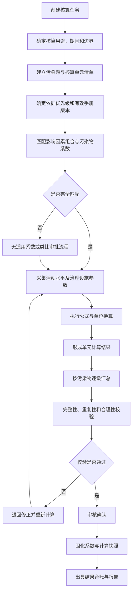

# 二污普系数计算业务梳理

> 文档性质：业务分析稿  
> 编制日期：2026-07-25  
> 编制原则：不以具体产品原型为依据，按照生态环境部公开的产排污核算体系独立梳理。  
> 适用重点：工业源产排污系数法。农业源、生活源、集中式污染治理设施和移动源采用各自手册，不应直接套用本文的工业源规则。

## 1. 文档结论

“二污普系数计算”不应被设计成一个简单的“系数 × 数量”计算器，而应定位为一套可追溯、可复核、可版本化的污染物产排量核算业务。

其核心链路是：

1. 明确核算对象、核算期间和核算用途；
2. 识别企业全部污染源、生产单元和核算环节；
3. 按行业、产品、原料、工艺、规模等影响因素匹配适用手册和系数组合；
4. 按系数单位采集对应的活动水平；
5. 结合治理技术平均去除效率和治理设施实际运行率计算产生量、去除量和排放量；
6. 对同一污染物的全部核算环节进行汇总；
7. 保留系数版本、输入数据、计算过程、依据附件和审核记录，使结果可以重算和追溯。

系统必须认识到：不同手册的影响因素、活动水平、公式和适用边界并不相同。行业系数、VOCs 通用源项、固体物料堆场等不能使用同一套固定字段和固定公式，应由“系数元数据 + 公式规则”驱动。

## 2. 政策与业务依据

### 2.1 当前有效依据

生态环境部于 2021 年发布《排放源统计调查产排污核算方法和系数手册》，用于规范排放源产排量核算方法和统一产排污系数。生态环境部 2025 年的公开答复进一步说明，该手册以“二污普”产排污系数为基础，调整完善后公开发布，分为工业源、农业源、生活源、集中式污染治理设施和移动源五册。

因此，业务上俗称的“二污普系数”，不应永久绑定到 2017 年普查时点的静态数据，而应使用主管部门公开的现行有效手册，并管理后续修订版本。

### 2.2 核算方法不是只有系数法

生态环境统计中的排放量核算方法包括：

- 监测数据法；
- 产排污系数法或排放因子法；
- 物料衡算法。

工业源重点调查单位在监测数据满足规范性要求时，优先采用监测数据法；监测数据不满足要求时，再采用产排污系数法（含物料衡算法）。

因此，“二污普系数计算”只是完整污染物核算体系中的一种方法，不应覆盖或否定合规监测数据。

### 2.3 不同用途的依据优先级不同

核算用途至少应区分：

- 生态环境统计；
- 建设项目环境影响评价或源强核算；
- 排污许可申请、执行报告；
- 环境保护税；
- 企业内部测算；
- 其他专项调查。

例如用于环境保护税时：

1. 属于排污许可管理的单位，优先使用排污许可证申请与核发技术规范规定的排（产）污系数或物料衡算方法；
2. 排污许可技术规范未规定时，再使用排放源统计调查制度规定的方法；
3. 仍无方法时，由省级生态环境主管部门结合实际制定抽样测算方法。

所以系统必须先确定“核算用途”，再确定依据优先级，不能默认所有场景都直接使用二污普行业系数。

## 3. 业务定位

### 3.1 业务目标

系统需要回答以下问题：

1. 企业在核算期内有哪些污染源和核算环节？
2. 每个核算环节适用哪一份手册、哪一条系数组合？
3. 系数对应的活动水平是什么，数据从哪里取得？
4. 污染物产生量是多少？
5. 污染治理设施实际去除了多少？
6. 污染物最终排放量是多少？
7. 同一污染物在企业、生产线、工序和排放口等层级的汇总值是多少？
8. 计算依据、输入值和结果能否被第三方复核？

### 3.2 建议一期范围

建议一期聚焦“工业源系数法核算”，覆盖：

- 工业行业产排污系数手册；
- 工业源固体物料堆场颗粒物核算手册；
- 工业源挥发性有机物通用源项手册；
- 固定系数、公式系数及手册规定的专用公式；
- 污染物产生量、去除量、排放量和企业汇总；
- 系数版本、证据附件、计算快照和审核留痕。

建议暂不混入：

- 自动监测、手工监测原始数据质量判定；
- 环评预测浓度、环境质量影响预测；
- 排放标准达标判定；
- 污染物许可排放限值判定；
- 环境保护税税额计算；
- 治理设施选型设计；
- 不同手册没有授权的经验系数自动推断。

这些能力可以与系数计算共享基础数据，但应作为独立业务模块建设。

## 4. 核心概念

| 概念 | 业务定义 |
|---|---|
| 核算任务 | 某主体针对特定期间、用途和边界发起的一次污染物核算 |
| 核算对象 | 企业、项目、生产线、工序、设施、排放口或区域 |
| 核算单元 | 可以独立匹配系数、填写活动水平和计算结果的最小业务单元 |
| 核算环节 | 产生污染物的工段、工艺、设施或通用源项 |
| 影响因素组合 | 手册用于唯一确定系数的维度组合，如行业、产品、原料、工艺、规模 |
| 污染物指标 | 废气、废水或固体废物相关指标 |
| 产污系数 | 单位活动水平对应的污染物产生量 |
| 排污系数 | 单位活动水平对应的污染物排放量；若已是排污系数，不得再次扣减治理效率 |
| 活动水平 | 与系数分母一致的产品产量、原料用量、燃料用量、运行时间、设备数量、周转量等 |
| 治理技术平均去除效率 | 手册针对某治理技术给出的平均去除效率 |
| 实际运行率 k | 反映治理设施实际运行状态的修正参数，通常在 0～1 之间，具体公式以手册为准 |
| 产生量 | 污染物进入治理前或按照手册口径核算的生成量 |
| 去除量 | 治理设施在核算期内去除的污染物量 |
| 排放量 | 产生量扣除去除量，并按手册要求处理回用等因素后的量 |
| 系数快照 | 任务计算时实际使用的系数、单位、公式、来源、版本和适用条件的不可变副本 |

## 5. 核算边界

### 5.1 时间边界

每个任务必须明确：

- 核算开始日期；
- 核算结束日期；
- 数据年度或报告期；
- 企业生产时间；
- 治理设施运行时间；
- 停产、检修、事故和异常工况时间。

活动水平、治理设施运行数据和结果必须属于同一核算期间。不能使用全年产量搭配某个月的治理设施运行率。

### 5.2 空间和组织边界

必须明确核算范围属于：

- 单个企业；
- 单个厂区；
- 单条生产线；
- 单个工段；
- 单套生产设施；
- 单个排放口；
- 区域整体。

企业级结果应由边界内各核算单元逐级汇总，不能直接用企业总产量重复套用到多个工段。

### 5.3 污染源边界

工业企业可能同时存在：

- 行业生产工艺源；
- 燃料燃烧源；
- 工业锅炉或炉窑；
- 固体物料堆场；
- VOCs 动静密封点；
- VOCs 有机液体储存和装载；
- VOCs 循环水；
- VOCs 防腐涂料使用；
- 废水处理和回用；
- 其他手册规定的源项。

业务必须先建立污染源清单，再进行系数匹配。只按污染物名称搜索系数容易漏算源项，也容易对同一源项重复计算。

## 6. 系数库业务模型

### 6.1 手册版本

每份手册至少记录：

- 手册名称；
- 污染源类型；
- 行业代码及版本；
- 发布机关；
- 公告文号；
- 发布日期；
- 实施日期；
- 失效日期；
- 文件版本或修订批次；
- 原始文件地址；
- 文件校验值；
- 当前状态：草稿、待校验、有效、已替代、失效。

任务应按“核算用途 + 核算期间 + 有效性规则”确定可选版本。已完成任务继续使用原系数快照，不因系数库更新自动改变历史结果。

### 6.2 系数组合

工业行业系数组合通常包含：

- 工段；
- 产品；
- 原料；
- 生产工艺；
- 生产规模；
- 污染类别；
- 污染物指标；
- 系数类型；
- 系数值或系数表达式；
- 系数单位；
- 末端治理技术；
- 治理技术平均去除效率；
- k 值参考公式；
- 适用说明和脚注。

这些字段不是所有手册都齐全。系统应以可配置影响因素建模，不应把“行业、产品、工艺、原料”写死为唯一组合。

### 6.3 系数类型

至少支持以下类型：

1. 固定产污系数；
2. 固定排污系数；
3. 含变量的公式系数；
4. 多参数专用计算公式；
5. 查表系数；
6. 分地区系数；
7. 分规模或区间系数；
8. 产生量等于排放量的直排系数；
9. 物料衡算规则；
10. 手册规定的其他算法。

“固定数值 × 活动水平”只能覆盖其中一部分。

### 6.4 治理技术

治理技术数据应与具体系数组合关联，至少包括：

- 治理技术名称；
- 适用污染物；
- 平均去除效率；
- k 值定义；
- k 值公式；
- k 值所需参数；
- 是否直排；
- 是否已包含收集效率；
- 是否允许治理技术组合；
- 来源页码及脚注。

不得把某行业、某工艺的治理效率直接作为全行业通用值。

## 7. 系数匹配规则

### 7.1 匹配顺序

推荐按照以下顺序匹配：

1. 确定污染源类型；
2. 确定核算用途对应的依据优先级；
3. 确定行业代码及适用手册；
4. 确定核算环节；
5. 逐项匹配产品、原料、工艺、规模等影响因素；
6. 确定污染物；
7. 确定系数及计量单位；
8. 确定末端治理技术、平均去除效率和 k 值规则；
9. 阅读手册适用范围、注意事项和脚注；
10. 由经办人确认匹配结果。

### 7.2 唯一匹配

一个核算单元在同一核算方法下，应唯一指向一条可执行的系数组合。

系统需要阻止：

- 同一源项重复选择相同系数；
- 从不同组合中拼接“更有利”的系数和治理效率；
- 忽略手册规定的规模、地区或工艺限制；
- 只按污染物名称选择系数；
- 使用已失效版本却不说明原因。

### 7.3 无完全匹配

找不到完全匹配的系数时，系统不应自动选择“最相近”结果，而应进入“无适用系数”流程：

1. 展示未匹配的影响因素；
2. 检查是否存在通用源项、排污许可技术规范或行业源强核算指南；
3. 检查手册是否明确允许参照某一工艺或行业；
4. 需要类比时，记录类比对象、相似性说明、差异修正、依据文件和审批意见；
5. 仍无依据时，转入物料衡算、监测数据或主管部门认可的其他方法；
6. 未经确认不得形成正式结果。

## 8. 活动水平采集

活动水平必须由系数单位反向决定。例如：

| 系数单位示例 | 需要采集的活动水平 |
|---|---|
| kg/t-产品 | 产品产量 |
| kg/t-原料 | 原料消耗量 |
| kg/t-燃料 | 燃料消耗量 |
| kg/万m³-燃料 | 气体燃料消耗量 |
| kg/m³-循环水 | 年循环水量 |
| kg/h/排放源 | 设备或密封点数量、运行时间 |
| kg/t-周转量 | 物料周转量 |
| kg/a | 数量或固定年度源项 |
| m³/t-产品 | 产品产量，用于计算废气量或废水量 |

每个活动水平值需要保存：

- 原始值；
- 原始单位；
- 标准化值；
- 标准单位；
- 数据来源；
- 统计口径；
- 对应期间；
- 证据附件；
- 填报人和确认人。

常见数据来源包括生产台账、物料台账、能源台账、计量仪表、采购领用记录、排污许可执行报告和经确认的统计报表。

## 9. 标准行业系数计算

以下公式适用于使用“产污系数 + 治理效率 + k 值”的常见行业手册。具体项目仍以所选手册为准。

### 9.1 产生量

$$
G_i = \rho_i \times M_i
$$

其中：

- $G_i$：核算单元 $i$ 的污染物产生量；
- $\rho_i$：对应产污系数；
- $M_i$：与系数单位一致的产品产量、原料用量或其他活动水平。

计算前必须完成单位换算。例如系数为 kg/t、活动水平为 t/a 时，直接计算得到 kg/a；汇总为 t/a 时再除以 1000。

### 9.2 去除量

$$
R_i = G_i \times \eta_i \times k_i
$$

其中：

- $R_i$：污染物去除量；
- $\eta_i$：末端治理技术平均去除效率；
- $k_i$：末端治理设施实际运行率。

### 9.3 排放量

$$
E_i = G_i - R_i
$$

即：

$$
E_i = G_i \times (1 - \eta_i \times k_i)
$$

### 9.4 企业汇总

同一污染物的企业级产生量和排放量，应为全部产品、原料、工艺、工段和核算环节的结果之和：

$$
G_{\text{total},p} = \sum_i G_{i,p}
$$

$$
E_{\text{total},p} = \sum_i E_{i,p}
$$

不得先将不同单位、不同活动水平或不同系数的记录简单合并后再计算。

## 10. k 值业务规则

### 10.1 k 值含义

k 值用于修正相同治理技术在不同企业实际运行状态下的去除效果。k 越接近 1，表示治理设施与生产过程越同步、运行越稳定。

常见参考公式为：

$$
k = \frac{\text{治理设施运行时间}}{\text{正常生产时间}}
$$

但不同手册可能给出其他参数或公式，因此系统不得将上述公式写死。

### 10.2 k 值校验

- 正常情况下取值范围为 0～1；
- 生产时间为 0 时不得计算；
- 治理设施运行时间大于生产时间时需要核实统计口径；
- 治理设施停运但生产设施运行时，应真实反映 k 值下降；
- 直排或无治理设施时，治理效率按手册口径取 0，不应伪造 k=1；
- 手册给出的 k 公式为参考公式时，采用其他表达方式必须记录依据和审核意见。

## 11. 排污系数与直排规则

系统必须区分“产污系数”和“排污系数”：

- 产污系数先算产生量，再按手册规则扣减去除量；
- 排污系数直接计算排放量，不得再次乘以 $(1-\eta k)$；
- 手册明确“产生量等于排放量”的源项，产生量和排放量取相同结果；
- 治理技术为“直排”或治理效率为 0 时，通常排放量等于产生量。

若不区分系数类型，会产生重复扣减或漏扣减。

## 12. 特殊源项

### 12.1 VOCs 通用源项

VOCs 通用源项包括但不限于：

- 设备动静密封点；
- 挥发性有机液体储存；
- 有机液体装载；
- 燃烧烟气；
- 循环水；
- 防腐涂料使用。

不同源项使用不同公式。例如：

- 动静密封点通常与密封点类型、数量、排放系数和运行时间有关；
- 储罐与地区、物料、罐型、容积、储存温度、周转量和储罐数量有关；
- 装载与物料、装载方式和装载量有关；
- 燃烧烟气与锅炉或炉窑类型、燃料类型及燃料消耗量有关；
- 循环水与循环水塔类型、行业和循环水量有关；
- 防腐涂料与涂料类型及使用量有关。

部分 VOCs 手册中的治理技术去除效率已经包含收集效率。系统必须读取该标识，不能再额外乘一次收集效率。

### 12.2 固体物料堆场颗粒物

堆场颗粒物包含装卸扬尘和风蚀扬尘，其产生量不是简单的单系数乘法，涉及：

- 年物料运载车次；
- 单车平均运载量；
- 地区风速概化系数；
- 物料含水率概化系数；
- 风蚀扬尘概化系数；
- 堆场面积。

排放量还要考虑粉尘控制措施效率和堆场类型控制效率：

$$
U_c = P \times (1-C_m) \times (1-T_m)
$$

因此堆场核算应作为独立算法模板，而不是普通行业系数的一行数据。

### 12.3 废水回用

手册要求扣除废水回用时，可按以下逻辑计算实际排放量：

$$
E_{\text{actual}} = E_{\text{calculated}} \times (1-r)
$$

其中 $r$ 为实际废水回用率。

回用率的口径、分母、对应排放口和核算期间必须一致。不得把企业总回用率直接套用到所有废水核算单元。

### 12.4 多产品、多工艺和多工段

- 每个产品、原料、工艺、工段分别匹配系数；
- 分别计算产生量、去除量和排放量；
- 最后按污染物汇总；
- 同一企业生产多个产品时，不能只选择产量最大的产品替代其他产品；
- 同一工段服务多个产品时，需要确定活动水平分摊规则并留痕。

### 12.5 多套治理设施

优先使用手册中已经给出的组合治理技术及其平均去除效率。

若手册没有对应组合，是否采用主要治理技术、串联效率或其他方法，应严格按照该行业手册说明或适用技术规范处理。系统不应自行将多个去除效率连续相乘，也不应简单相加。

## 13. 监测浓度法与系数法的关系

浓度、流量和运行时间相乘属于监测数据法或相关技术规范规定的实测核算，不是标准行业产污系数法本身。

常见废气排放量计算形式为：

$$
E = C \times Q \times T \times 10^{-9}
$$

其中：

- $C$：污染物质量浓度，mg/m³；
- $Q$：废气流量，m³/h；
- $T$：排放时间，h；
- $E$：排放量，t。

业务上需要做到：

- 监测法和系数法分别保存核算链路；
- 不将“处理后浓度”任意替代手册中的治理效率；
- 同一污染物同一源项不能在最终总量中重复叠加两种方法；
- 可以将两种方法的结果用于合理性比对；
- 最终采用哪种方法，应由核算用途和适用规范决定。

## 14. 业务流程

### 14.1 流程总览

### 14.2 状态建议

| 状态 | 含义 |
|---|---|
| 草稿 | 仅建立任务，允许修改核算边界 |
| 待识别 | 污染源或核算单元尚未识别完整 |
| 待匹配 | 存在未匹配系数的核算单元 |
| 待填报 | 系数已匹配，但活动水平或治理参数不完整 |
| 待计算 | 数据完整，尚未执行或需要重新执行计算 |
| 待校验 | 已计算，等待系统规则校验和经办人确认 |
| 待审核 | 经办人已提交，等待复核 |
| 已完成 | 审核通过，结果和依据已固化 |
| 已作废 | 任务作废，保留原始记录和作废原因 |

任何影响系数、活动水平、治理参数或公式版本的修改，都应使结果失效并回到“待计算”状态。

## 15. 数据模型

### 15.1 核算任务

- 任务编号；
- 任务名称；
- 核算主体；
- 统一社会信用代码；
- 厂区或项目；
- 所属行政区；
- 核算用途；
- 核算期间；
- 核算边界；
- 采用方法；
- 状态；
- 经办人、审核人；
- 创建、提交、审核和完成时间。

### 15.2 核算单元

- 所属任务；
- 生产线、工段或设施；
- 源项类型；
- 排放口或去向；
- 行业代码；
- 产品、原料、工艺、规模；
- 污染物；
- 是否有组织；
- 是否纳入汇总；
- 与其他单元的防重复标识。

### 15.3 系数快照

- 手册及版本；
- 适用范围；
- 影响因素组合；
- 系数类型；
- 系数原值；
- 系数表达式；
- 系数单位；
- 治理技术；
- 平均去除效率；
- k 值公式；
- 脚注、来源页码和原文摘录；
- 快照生成时间；
- 快照校验值。

### 15.4 参数记录

- 参数名称；
- 参数业务含义；
- 原始值和原始单位；
- 标准值和标准单位；
- 参数期间；
- 数据来源；
- 证据附件；
- 是否人工修正；
- 修正前值、修正理由和审批记录。

### 15.5 结果记录

- 计算公式标识及版本；
- 实际产污系数；
- 产生量；
- 去除量；
- 排放量；
- 标准单位；
- 中间计算值；
- 舍入前值；
- 展示值；
- 警告信息；
- 计算时间；
- 计算引擎版本。

## 16. 计算引擎要求

### 16.1 规则驱动

计算引擎应由以下内容驱动：

- 系数类型；
- 参数定义；
- 参数单位；
- 公式表达式；
- 条件分支；
- 查表规则；
- 汇总规则；
- 精度规则；
- 适用版本。

不建议在页面或业务代码中为每个行业硬编码公式。

### 16.2 单位引擎

单位应拆分为：

- 分子量纲，如 kg、g、t、m³；
- 分母活动水平，如 t-产品、t-原料、万m³-燃料、台、个、m²；
- 时间口径，如 h、d、a；
- 标准状态标识，如 m³ 与 Nm³。

系统只允许量纲兼容的值相乘、换算和汇总。单位文字相似但业务分母不同的系数不得混用。

### 16.3 精度

建议：

- 原始系数按手册精度保存，不截断；
- 中间计算使用高精度十进制；
- 只在最终展示或报表层舍入；
- 同一任务统一展示精度；
- 保存舍入前值和舍入后值；
- 汇总采用舍入前值求和，避免逐行舍入误差累积。

## 17. 数据校验与质量控制

### 17.1 完整性校验

- 是否覆盖全部生产线、工段和通用源项；
- 每个核算单元是否已确定核算方法；
- 系数必需影响因素是否齐全；
- 活动水平和治理参数是否齐全；
- 公式变量是否全部赋值；
- 是否存在未处理的无适用系数记录；
- 是否上传必要的证据附件。

### 17.2 合法性校验

- 活动水平不得为负数；
- 百分比参数应在 0～100%；
- k 值通常应在 0～1；
- 时间、数量、面积、流量等应符合参数定义；
- 实施日期晚于核算期间的手册不得默认使用；
- 失效手册不得用于新任务，除非有明确依据；
- 产污系数和排污系数不得混淆；
- 已包含收集效率的治理效率不得重复计算。

### 17.3 一致性校验

- 活动水平期间与任务期间一致；
- 治理设施运行时间与对应生产设施匹配；
- 产品产量与生产台账一致；
- 原料用量与物料台账一致；
- 同一参数在多个核算单元共享时取值一致；
- 汇总结果等于明细结果之和；
- 产生量、去除量和排放量满足数量关系。

### 17.4 防重复校验

重点识别：

- 行业工艺系数与通用源项重复；
- 同一生产线被拆成多个单元后重复使用总产量；
- 同一排放口同时叠加监测法和系数法；
- VOCs 行业系数与 VOCs 通用源项重复；
- 燃料燃烧污染物在产品工艺系数和锅炉/炉窑系数中重复；
- 同一核算单元重复选择同一系数组合。

### 17.5 合理性校验

- 排放量一般不应大于产生量；
- 去除量一般不应大于产生量；
- 治理效率显著偏离手册参考值时预警；
- 活动水平较上期变化异常时预警；
- 单位产品产生量或排放量较历史任务明显异常时预警；
- 系数法结果与有效监测结果差异过大时预警，但不自动覆盖结果。

## 18. 审核与追溯

### 18.1 角色

| 角色 | 主要职责 |
|---|---|
| 系数库管理员 | 导入、校验和发布手册版本及计算规则 |
| 经办人 | 建立核算边界、匹配系数、填报参数和提交计算 |
| 复核人 | 复核适用依据、系数匹配、活动水平、治理参数和结果 |
| 审批人 | 对类比系数、人工修正、特殊算法等例外事项审批 |
| 查阅人 | 查看已完成结果和证据，不修改数据 |

### 18.2 必须留痕的操作

- 手册版本变更；
- 系数人工调整；
- 活动水平调整；
- 治理技术或 k 值调整；
- 核算单元新增、删除；
- 核算方法切换；
- 类比系数选择；
- 重新计算；
- 审核退回；
- 任务作废；
- 已完成任务复制或修订。

### 18.3 完成任务的不可变性

任务完成后应固化：

- 核算边界；
- 系数快照；
- 参数快照；
- 公式版本；
- 中间过程；
- 结果；
- 依据附件；
- 审核意见。

需要修改时应创建新版本或修订任务，不直接覆盖原结果。

## 19. 输出成果

### 19.1 计算明细台账

至少包含：

- 核算单元；
- 手册和系数来源；
- 影响因素组合；
- 污染物；
- 系数及单位；
- 活动水平；
- 治理技术；
- 平均去除效率；
- k 值及计算过程；
- 产生量；
- 去除量；
- 排放量；
- 计算公式和备注。

### 19.2 汇总结果

建议支持：

- 按污染物汇总；
- 按污染类别汇总；
- 按生产线、工段和设施汇总；
- 按有组织、无组织或源项类别汇总；
- 按排放口或排放去向汇总；
- 按核算方法汇总；
- 按手册版本汇总。

“有组织/无组织”仅在所用手册或核算方法明确支持时汇总，不能凭系统默认规则拆分。

### 19.3 核算说明书

应自动生成：

- 核算目的和范围；
- 核算期间；
- 依据文件；
- 污染源识别结果；
- 核算方法选择说明；
- 系数匹配说明；
- 参数来源；
- 计算公式；
- 计算结果；
- 异常与假设；
- 审核结论；
- 附件目录。

## 20. 关键业务场景

系统验收至少覆盖以下场景：

1. 固定产污系数 × 产品产量；
2. 固定产污系数 × 原料用量；
3. 燃料消耗量作为活动水平；
4. 公式型产污系数需要补充变量；
5. 直排，产生量等于排放量；
6. 使用治理技术平均去除效率和 k 值；
7. 治理设施未全年同步运行，k 小于 1；
8. 一个污染物由多个产品、工艺或工段产生；
9. 多个污染物共用同一活动水平；
10. 废水回用扣减；
11. VOCs 动静密封点；
12. VOCs 储存和装载；
13. 固体物料堆场颗粒物；
14. 无适用系数转类比或其他核算方法；
15. 系数库发布新版本后重算新任务；
16. 历史任务继续按旧快照复现；
17. 监测法与系数法结果对比但不重复汇总；
18. 同一源项重复选择时拦截；
19. 单位不兼容时拦截；
20. 已完成任务修订时保留原版本。

## 21. 推荐产品原则

1. 先识别污染源，再搜索系数；
2. 先确定用途，再确定依据优先级；
3. 影响因素必须完整匹配，不只按污染物匹配；
4. 系数、治理效率和 k 值必须来自同一适用组合；
5. 参数字段由公式和单位动态生成；
6. 计算过程必须展示，不能只给最终数字；
7. 无适用系数必须显式暴露，不自动猜测；
8. 结果必须可以重算、复核和追溯；
9. 历史结果使用快照，不跟随系数库静默变化；
10. 特殊源项采用专用模板，不强行套用通用公式；
11. 系数法与监测法、物料衡算法并列管理；
12. 系统给出计算结果，不替代专业人员对适用性的判断。

## 22. 后续需要确定的产品决策

在进入详细需求或系统设计前，需要明确：

1. 系统的主要用途是生态环境统计、环评源强、排污许可、环保税还是企业内部测算；
2. 一期是否只做工业源；
3. 是否覆盖废气、废水和固体废物全部指标；
4. 是否同时支持监测数据法和物料衡算法；
5. 系数库由谁维护、谁审核、谁发布；
6. 是否需要解析并导入全部行业 PDF 手册；
7. 类比系数由谁审批；
8. 企业、生产线、排放口等基础数据来自哪个系统；
9. 是否需要与排污许可证、执行报告和环境统计数据联动；
10. 结果是否需要用于正式报送，若用于报送需满足哪些格式和签审要求；
11. 是否需要支持地区自定义系数，以及其优先级和有效范围；
12. 是否需要建立监测结果与系数结果的差异分析机制。

## 23. 官方资料

1. [生态环境部公告 2021 年第 24 号：《排放源统计调查产排污核算方法和系数手册》](https://www.mee.gov.cn/xxgk2018/xxgk/xxgk01/202106/t20210618_839512.html)
2. [《排放源统计调查产排污核算方法和系数手册》总册](https://www.mee.gov.cn/xxgk2018/xxgk/xxgk01/202106/W020210624327149500026.pdf)
3. [生态环境部答复：产排污系数手册的有效版本及使用方法](https://www.mee.gov.cn/hdjl/cjwt/202509/t20250915_1130226.shtml)
4. [《生态环境统计管理办法》](https://www.mee.gov.cn/gzk/gz/202301/t20230119_1013882.shtml)
5. [关于计算环境保护税应税污染物排放量的排污系数和物料衡算方法的公告](https://www.mee.gov.cn/xxgk2018/xxgk/xxgk01/202104/t20210430_831400.html)
6. [工业源挥发性有机物通用源项产排污核算系数手册](https://www.mee.gov.cn/uplodfile/%E9%99%841%E5%B7%A5%E4%B8%9A%E6%BA%90-%E9%99%84%E8%A1%A83%20%E5%B7%A5%E4%B8%9A%E6%BA%90%E6%8C%A5%E5%8F%91%E6%80%A7%E6%9C%89%E6%9C%BA%E7%89%A9%E9%80%9A%E7%94%A8%E6%BA%90%E9%A1%B9%E6%A0%B8%E7%AE%97%E7%B3%BB%E6%95%B0%E6%89%8B%E5%86%8C.pdf)
7. [工业源固体物料堆场颗粒物核算系数手册](https://www.mee.gov.cn/uplodfile/%E9%99%841%E5%B7%A5%E4%B8%9A%E6%BA%90-%E9%99%84%E8%A1%A82%20%E5%B7%A5%E4%B8%9A%E6%BA%90%E5%9B%BA%E4%BD%93%E7%89%A9%E6%96%99%E5%A0%86%E5%9C%BA%E9%A2%97%E7%B2%92%E7%89%A9%E6%A0%B8%E7%AE%97%E7%B3%BB%E6%95%B0%E6%89%8B%E5%86%8C.pdf)
8. [2623 钾肥制造行业系数手册（含标准计算示例）](https://www.mee.gov.cn/uplodfile/2623%E9%92%BE%E8%82%A5%E5%88%B6%E9%80%A0%E8%A1%8C%E4%B8%9A%E7%B3%BB%E6%95%B0%E6%89%8B%E5%86%8C.pdf)

---

本文是面向业务和系统建设的归纳，不构成具体企业、具体报告或行政管理场景中的合规结论。实际核算时，应以核算期间有效的法律法规、排污许可技术规范、源强核算指南、统计制度、行业系数手册及主管部门要求为准。
